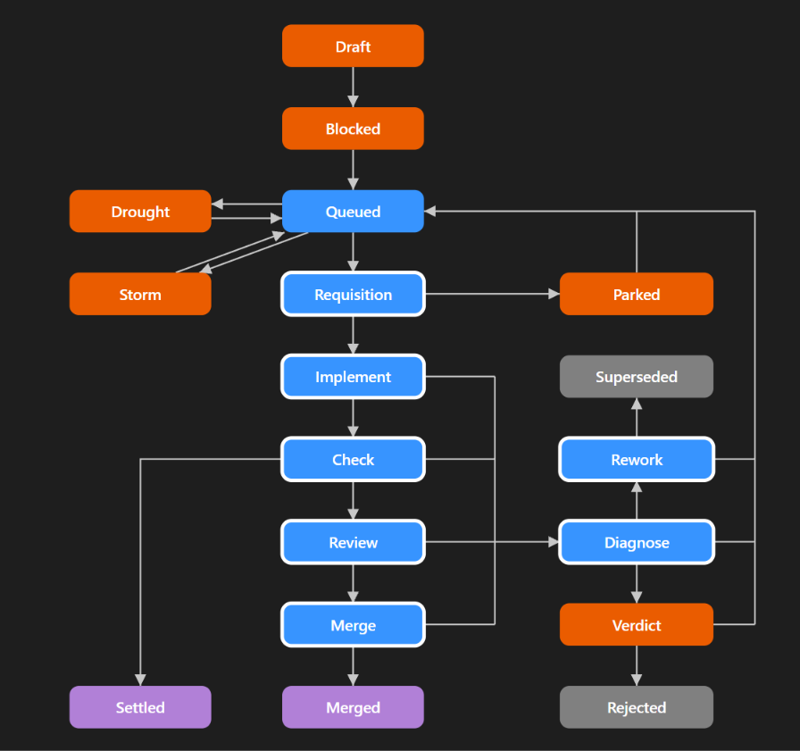

# clutch tickets

A VS Code extension for the [clutch](https://pypi.org/project/clutchwork/) ticket system. View clutch tickets in the Activity Bar. The Tickets view shows the dependency graph and ticket states; Details shows the selected ticket or Suggestion Box message. Recent Steps shows engine activity, Suggestion Box lists messages, and Stats shows health figures.

Built for [clutch 0.2.4](https://pypi.org/project/clutchwork/0.2.4/).

## Prerequisites

Open a repository containing `tickets/` and [install clutch](https://github.com/protus75/clutchwork/blob/main/clutch/docs/host-contract.md#install).

The `clutch.command` setting is the command and arguments used to run the engine. The default is `[".venv/bin/clutch"]`, resolved from the workspace folder. Override it when the executable is elsewhere, including on native Windows. A missing command shows a `clutch command not found` message naming the `clutch.command` setting.

On WSL or Remote-SSH, the extension runs on the remote side, where the repository and clutch command are available.

## Help

Hover over extension surfaces for help, or use the links in Details under `Next` to learn about available actions. The Help command lists all topics, and settings include their own help. In an error state, the "Open setup help" link opens this README.
